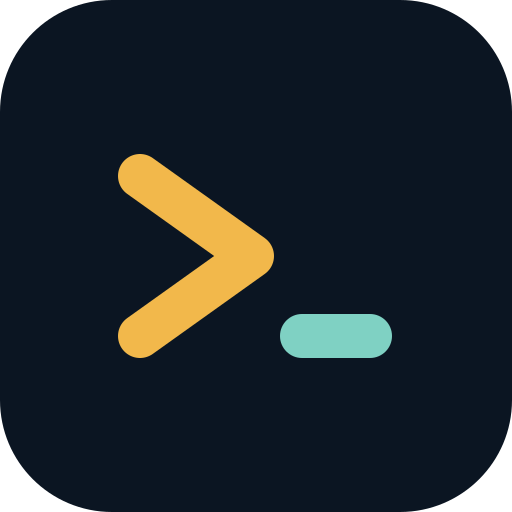
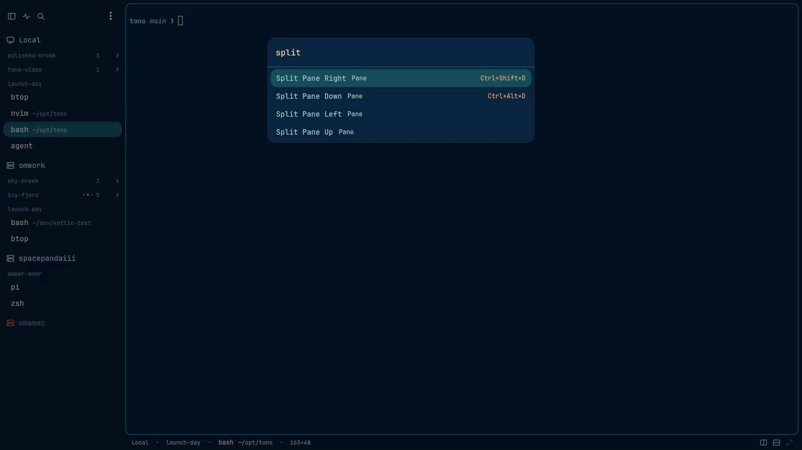
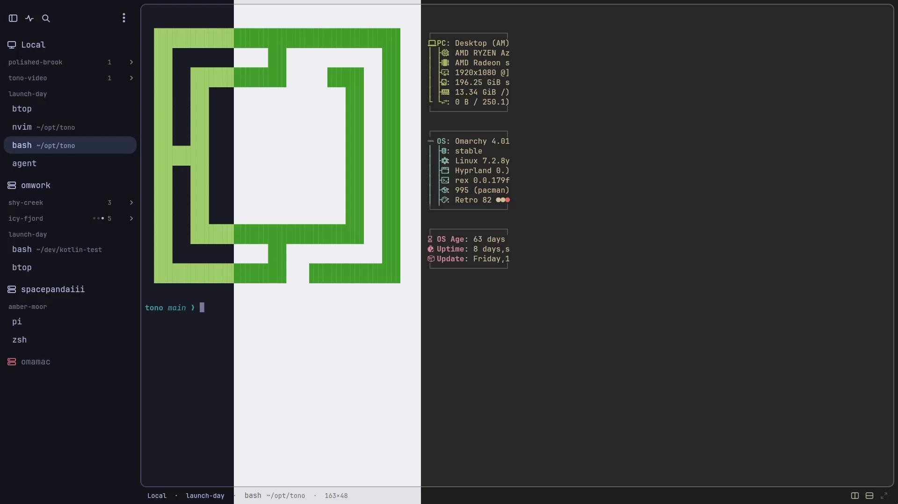

<p align="center">
  
</p>

<h1 align="center">Tono</h1>

<p align="center">An opinionated Rex client for Omarchy.</p>


[Rex](https://www.superlogical.com/rex) keeps your terminals running on a server, so you can leave them and come back
from anywhere. Tono is a client for it, made for the [Omarchy](https://omarchy.org) desktop. It puts the sessions and
tabs of every machine you have in one sidebar and uses your desktop's colors and font. It is built to be used from
the keyboard.

*Rex* is Latin for king. *Tono* (殿) is Japanese for lord.

## Who it's for

Tono is for people who use Rex and work on Omarchy. It helps most if your sessions are spread over several machines
and you want them in one place, or if you run agents in terminals and want to know which one is waiting for you. It
has no settings for colors or fonts, so it suits you if you want a terminal that matches your desktop without being
configured.

## What it does

<table>
  <tr>
    <td width="50%"></td>
    <td width="50%"></td>
  </tr>
  <tr>
    <td>Ghostty's terminal core draws the terminals, so Neovim, btop, the mouse and pictures all work.</td>
    <td>A tab shows whether its program is working, waiting for you, or done. When a program in a tab you aren't watching needs you, Tono plays a sound. The agent in this picture is a stand-in script.</td>
  </tr>
  <tr>
    <td></td>
    <td></td>
  </tr>
  <tr>
    <td>The command palette finds any command, session, tab or machine as you type.</td>
    <td>You can split a tab into panes, to the right or downward, then move between them and zoom one.</td>
  </tr>
  <tr>
    <td></td>
    <td></td>
  </tr>
  <tr>
    <td>When you change Omarchy's theme, Tono changes with it, terminals included.</td>
    <td>The same app runs as a web page, for your other devices. It is served over your tailnet, and only to you.</td>
  </tr>
</table>

When Tono starts, it connects to all your Rex servers and puts you back where you were on each. It also offers to
add the Rex servers it finds on your tailnet. A machine that goes to sleep turns red in the sidebar, and Tono
reconnects to it when it wakes.

## The opinions

- Tabs go down the side, in one list across every session and every machine. Control and a digit takes you to a tab
  wherever it is.
- There is no theme setting and no font setting. Tono uses Omarchy's.
- Commands have the names and shortcuts they have in Rex's Mac app, with Control in place of Command. Keys you bind
  in Rex's `init.lua` apply here as well.
- A tab is named after the program running in it and that program's directory, as in `nvim ~/dev/rex`. If you name a
  tab yourself, the name stays and shows in every client.
- Machine names are small, and tabs are the brightest thing in the sidebar. Tono makes no sound about the tab you
  are looking at.

## Try it

You need a running Rex server and [mise](https://mise.jdx.dev). Tono is built for Omarchy and hasn't been tried on
any other desktop.

```sh
git clone https://github.com/masegraye/tono && cd tono
mise trust && mise install   # Task, Java and Zig, for this directory only
task install                 # builds it and installs the `tono` command
tono
```

The first build downloads and builds Ghostty's terminal core, which takes about two minutes. After that Tono is in
your app launcher and no longer needs the checkout. [Installing](docs/install.md) has the details.

## Where it stands

Tono is early and unofficial. The two gaps you are most likely to notice first are that you can't select text with
the mouse, and that it doesn't connect to SSH hosts. The browser version has been tried in Chromium and a little in
Firefox, but not in Safari, and its phone layout has only been tried in a desktop browser's phone mode. Planned work
is in [the backlog](agent-workspace/backlog/readme.md).

## Read more

- [Installing](docs/install.md) covers what you need, and how to update or remove it.
- [Using Tono](docs/using-tono.md) explains machines, the sidebar, tabs and shortcuts.
- [Tono in a browser](docs/web.md) covers serving it, who can reach it, the keyboard and phones.
- [How it works](docs/how-it-works.md) describes the protocol, the terminal, pictures and the clipboard.
- [Working on Tono](docs/development.md) lists the modules, the tasks and the tests.
- [Omarchy theming](docs/omarchy-theming.md) describes the theme libraries, which other apps can use.

## Credits

Tono is an independent, unofficial client, and it depends on other people's work.

- [Rex](https://www.superlogical.com/rex), by Superlogical, is the terminal multiplexer Tono is a client for. Tono
  takes its behaviour, command names and shortcuts from Rex's Mac app.
- [Rex Rune](https://github.com/shuv1337/rex-rune), by shuv, is another unofficial Linux client for Rex, written in
  Rust. It was Tono's reference implementation: where Rex's documentation didn't say how a client should behave,
  Tono follows what Rex Rune's source and notes say. The two share no code.
- [Ghostty](https://ghostty.org)'s terminal core, libghostty-vt, does the terminal emulation.
- [Omarchy](https://omarchy.org) is the desktop Tono is made for, and its colors and font come from there.

## License

[MIT](LICENSE).
