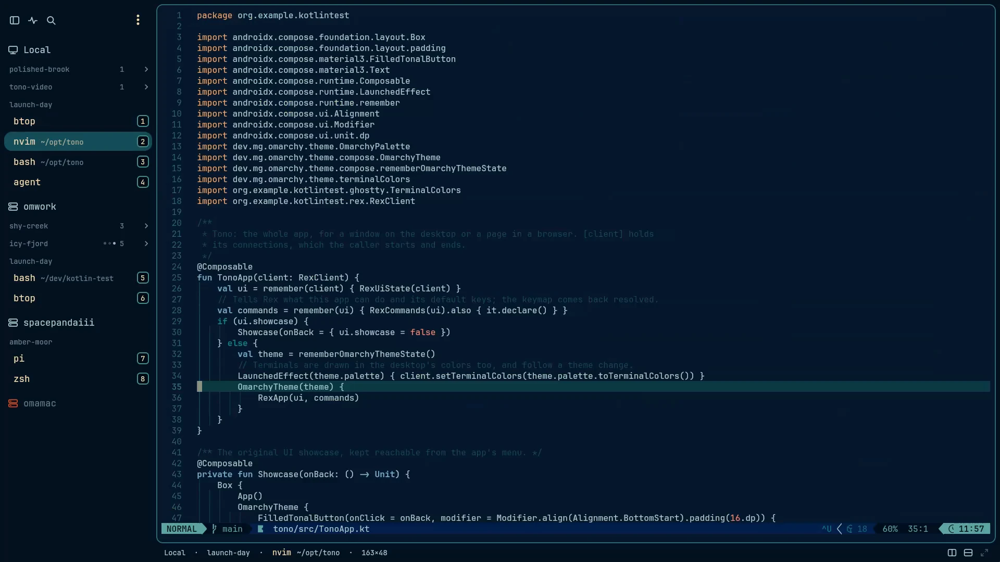
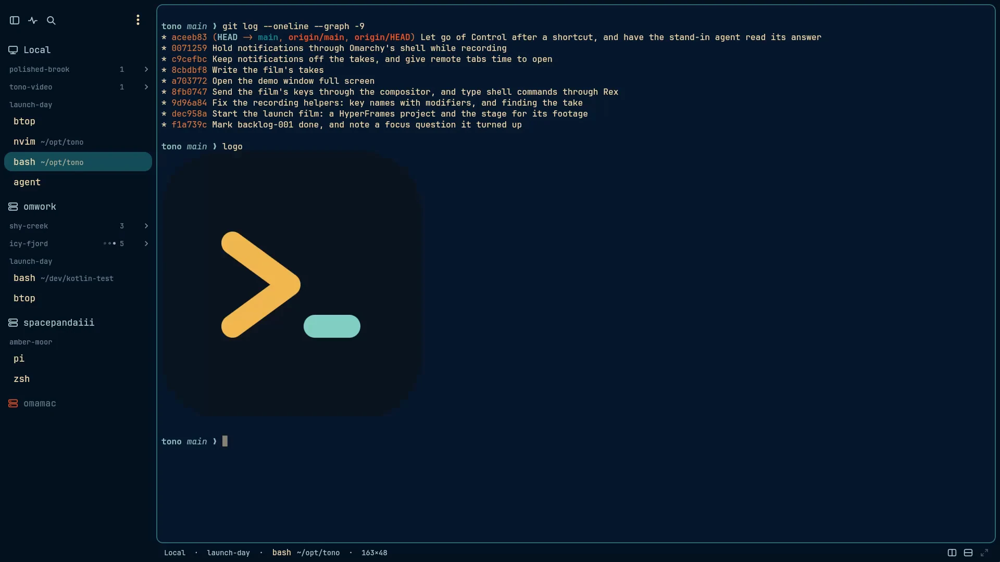
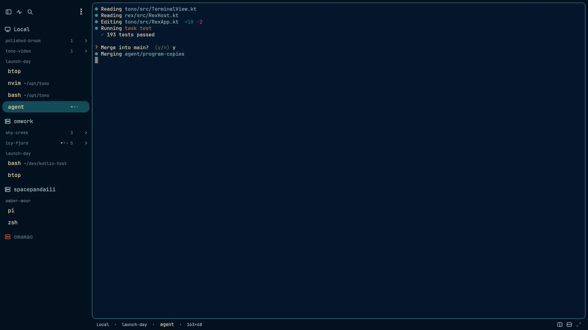
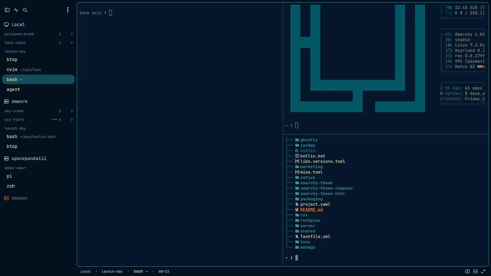
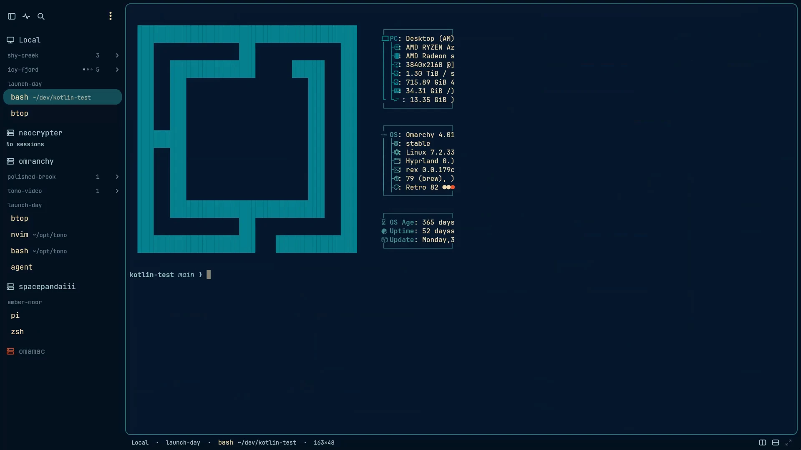

<p align="center">
  
</p>

<h1 align="center">Tono</h1>

<p align="center"><b>An opinionated Rex client for Omarchy.</b></p>



[Rex](https://www.superlogical.com/rex) keeps your terminals running on a server, so you can leave them and come back
from anywhere. Tono is the way in from an [Omarchy](https://omarchy.org) desktop: every machine you have in one
sidebar, in your desktop's colors and font, driven from the keyboard.

*Rex* is Latin for king. *Tono* (殿) is Japanese for lord.

## Who it's for

- You use Rex, and you work on Omarchy.
- Your sessions are spread over several machines, and you want them in one place.
- You run agents in terminals, and want to know which one is waiting for you.
- You would rather a tool looked right than had settings for it.

## What it does

<table>
  <tr>
    <td width="50%"></td>
    <td width="50%"></td>
  </tr>
  <tr>
    <td><b>Real terminals.</b> Ghostty's terminal core draws them, so Neovim, btop, the mouse and pictures all work.</td>
    <td><b>Agents you can leave.</b> A tab shows whether its program is working, waiting for you, or done, and a sound tells you when one you aren't watching needs you. (The agent here is a stand-in script.)</td>
  </tr>
  <tr>
    <td></td>
    <td></td>
  </tr>
  <tr>
    <td><b>A palette for everything.</b> Every command, session, tab and machine, a few letters away.</td>
    <td><b>Panes.</b> Split a tab right or down, move between panes, zoom one.</td>
  </tr>
  <tr>
    <td></td>
    <td></td>
  </tr>
  <tr>
    <td><b>Your theme, live.</b> Change Omarchy's theme and Tono changes with it, terminals included.</td>
    <td><b>In a browser too.</b> The same app as a web page, for your other devices, over your tailnet and for you alone.</td>
  </tr>
</table>

And every machine at once: Tono connects to all your Rex servers when it starts, puts you back where you were on
each, and offers to add the ones it finds on your tailnet. A machine that goes to sleep turns red, and comes back by
itself.

## The opinions

- **Tabs go down the side.** One list, across every session and every machine. Control and a digit takes you to a
  tab wherever it lives.
- **It has no look of its own.** There is no theme setting and no font setting. Both are Omarchy's.
- **Rex's keys, not new ones.** The commands, their names and their shortcuts are those of Rex's Mac app, with
  Control for Command. Keys you bind in Rex's `init.lua` apply here as well.
- **Tabs name themselves.** A tab is called by what is running in it and where (`nvim ~/dev/rex`). Name one yourself
  and that name sticks, in every client.
- **Quiet until it matters.** Machine names are small, tabs are what you see, and nothing makes a sound about the
  tab you are looking at.

## Try it

You need a running Rex server and [mise](https://mise.jdx.dev). Tono is built for Omarchy, and hasn't been tried on
any other desktop.

```sh
git clone https://github.com/masegraye/tono && cd tono
mise trust && mise install   # Task, Java and Zig, for this directory only
task install                 # builds it and installs the `tono` command
tono
```

The first build downloads and builds Ghostty's terminal core, which takes about two minutes. After that Tono is in
your app launcher, and no longer needs the checkout. More in [Installing](docs/install.md).

## Where it stands

Tono is early and unofficial. Two things you will miss soonest: selecting text with the
mouse, and SSH hosts. In a browser it has been tried in Chromium and a little in Firefox, never in Safari, and its
phone layout only in a desktop browser's phone mode. What's planned is in
[the backlog](agent-workspace/backlog/readme.md).

## Read more

- [Installing](docs/install.md): requirements, updating, removing.
- [Using Tono](docs/using-tono.md): machines, the sidebar, tabs, shortcuts.
- [Tono in a browser](docs/web.md): serving it, who can reach it, the keyboard, phones.
- [How it works](docs/how-it-works.md): the protocol, the terminal, pictures, the clipboard.
- [Working on Tono](docs/development.md): the modules, the tasks, the tests.
- [Omarchy theming](docs/omarchy-theming.md): the theme libraries, which other apps can use.

## Credits

Tono is an independent, unofficial client. It stands on other people's work:

- **[Rex](https://www.superlogical.com/rex)**, by Superlogical, is the terminal multiplexer Tono is a client for. Its
  Mac app is where Tono's behaviour, command names and shortcuts come from.
- **[Rex Rune](https://github.com/shuv1337/rex-rune)**, by shuv, is another unofficial Linux client for Rex, written
  in Rust. It was Tono's reference: where Rex's documentation didn't say how a client should behave, Rex Rune's
  source and notes did, and Tono follows it. No code is shared.
- **[Ghostty](https://ghostty.org)**'s terminal core, libghostty-vt, does the terminal emulation.
- **[Omarchy](https://omarchy.org)** is the desktop Tono is made for, and where its colors and font come from.

## License

[MIT](LICENSE).
