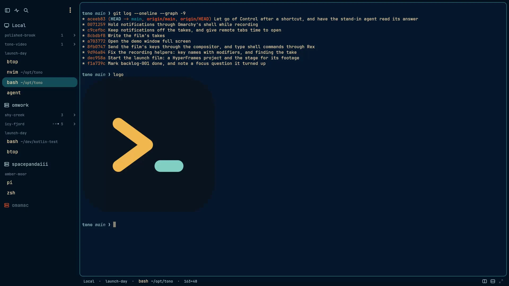

# How it works

Tono is a Kotlin Multiplatform app. The interface is Compose, the terminal emulation is Ghostty's, and the Rex
client underneath has no interface at all. The same code runs in a window on the desktop and in a browser.

## The protocol

A Rex server documents its own API (`GET /llms.txt` on its socket). The [rex](../rex/src) module speaks it: one
JSON control connection per server, and one binary data connection for each terminal on screen.

## Terminal emulation

A terminal's stream opens with a snapshot in Ghostty's format, so Tono uses Ghostty's terminal core, libghostty-vt,
to restore it and to interpret the output that follows.

- [native/](../native) builds that library from the Ghostty source pinned in [GHOSTTY.lock](../native/GHOSTTY.lock).
- [ghostty](../ghostty/src) calls it. On the desktop that is through Java's foreign function API, with bindings
  generated from the library's headers. In a browser it is a WebAssembly module (see
  [Tono in a browser](web.md#what-the-server-does-for-the-page)).

## Drawing

libghostty-vt reports which rows changed. [TerminalView.kt](../tono/src/TerminalView.kt) draws the cells on a
Compose canvas, in the Omarchy font and colors, and recolors when the desktop's theme changes.

## Typing

Key events go to the server as they came from the keyboard. The server applies key bindings and encodes them for
the terminal. Pasted text is made safe and framed by libghostty-vt's paste encoder, bracketed when the program asks
for that.

[RexActions.kt](../tono/src/RexActions.kt) is the table of what the app can do and its default keys. The server's
own actions, such as Clear Terminal, appear in the palette as well.

## Pictures

Programs can show pictures with the Kitty graphics protocol (`kitten icat`, previews in file managers, plots).
libghostty-vt keeps the pictures and works out where each goes; Tono decodes PNGs for it and draws them, scaled to
cover the same cells as in the terminal's owner. Pictures come back with a terminal's snapshot, so they are still
there after going to another tab and back.

**Only pixels sent in the output are accepted.** The protocol's ways of naming a file or shared memory to read are
turned off, so what a remote program prints can't make your machine read its own files.

## The mouse

A program that tracks the mouse (Neovim, htop, tmux) says so by setting terminal modes, which libghostty-vt keeps.
Its mouse encoder turns each click, drag, movement and wheel notch into the report the program asked for, or into
nothing if it didn't ask. Over a program that isn't tracking, the wheel scrolls the terminal's own history.

## The clipboard

A program can put text on your clipboard by writing OSC 52, as Neovim does when it yanks to the clipboard, and
tmux, and an agent's copy button. The rules:

- **Only the terminal in use may do it**: the pane with the keyboard, in the tab on screen, while the window has
  focus and neither the palette nor a dialog is open. A copy from anywhere else is dropped, so a program out of
  sight can't replace what you were about to paste.
- **Text over 8 MiB is refused**, and of several copies at once the last is the one kept.
- **A program's request to read the clipboard is never answered.** Nothing a program prints can get at what you
  have copied.

A browser lets a page write to the clipboard only when it is served securely (localhost counts) and has focus, and
some browsers only just after a key press or a click. When one refuses, the debug log says so.

These are Rex Rune's rules.

## Connections

A dropped connection is retried, and everything is read again when it comes back. A terminal's stream is reopened
from a new snapshot, not resumed.

A machine that goes to sleep closes nothing, so its connection looks open for as long as nobody writes to it. Tono
therefore asks a server that has been silent for ten seconds for its status. Any answer will do; no answer for ten
more seconds and the server is treated as down. The watch is `awaitSilence` in
[RexControl.kt](../rex/src/RexControl.kt).

## The keymap

The keys aren't fixed in the app. Tono declares its actions and their default keys to your home server, which lays
your Rex configuration on top and answers with what each key does. Changes take effect when Rex reloads its
configuration.

## Tab names

Rex stores only a label per window, which is a placeholder such as `Window 89abcdef` until someone sets it. What to
show in place of the placeholder is each client's choice. Tono makes it from the process the server reports for the
terminal: the foreground program of the focused pane, and its directory.

## Where things are

| Module | What it is |
|---|---|
| [tono](../tono) | The interface, shared by the desktop and the web |
| [rex](../rex) | The Rex client with no interface: connections, sessions, live terminals |
| [ghostty](../ghostty) | libghostty-vt, as a shared library on the desktop and WebAssembly in a browser |
| [desktopApp](../desktopApp) | Puts Tono in a window |
| [webApp](../webApp), [server](../server) | Puts Tono on a web page, and serves it |
| [omarchy-theme](../omarchy-theme), `-compose`, `-ktor` | Read the Omarchy theme, make a Compose theme of it, serve it to web pages |

The rest is in [Working on Tono](development.md).
