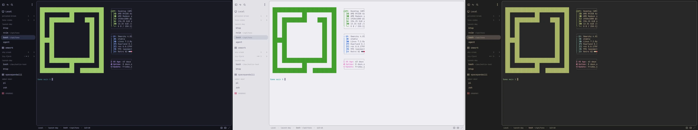

# Omarchy theming



Tono takes its colors and its font from [Omarchy](https://omarchy.org). It follows whichever theme is applied,
including themes you install later, and restyles itself the moment the theme changes. Nothing is rebuilt or
reloaded, and terminals recolor with everything else.

## The libraries

That behaviour comes from three modules that know nothing about Tono, so another app can use them as they are:

- **[omarchy-theme](../omarchy-theme)** reads the files Omarchy writes for the current theme, and watches them.
- **[omarchy-theme-compose](../omarchy-theme-compose)** turns a theme into a Compose Material theme, and sets text
  in the Omarchy font.
- **[omarchy-theme-ktor](../omarchy-theme-ktor)** serves the theme to web pages, and pushes each change to them.

They are described in [omarchy-theme/README.md](../omarchy-theme/README.md).

## What Tono does with them

- **On the desktop**, the app reads Omarchy's files directly. Under Hyprland it also draws at the focused monitor's
  scale; set `OMARCHY_UI_SCALE` (for example `1.5`) to override that.
- **In a browser**, a page can't read the desktop's files, so the server pushes each change to it. The server hands
  over the desktop's monospace font as well.
- **Where there is no Omarchy to ask** (Android, iOS, a web build served without the server), the app uses one of
  four stock palettes built into the library.

## The showcase

Tono began as a showcase of Compose Multiplatform, and the showcase is still there, under Tono's menu and as the
Android and iOS apps: Material 3 components, inputs, lists and pagers, animation, canvas drawing and gestures, one
file per tab in [shared/src](../shared/src).

Its Theming tab previews other palettes: every installed theme on the desktop, the built-in ones elsewhere. A
preview only affects the app, and ends when the desktop's theme changes.

```sh
./kotlin run -m androidApp
./kotlin run -m iosApp       # on a Mac
```
