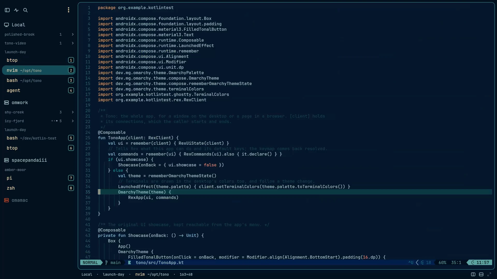

# Using Tono

When Tono starts, it connects to all your Rex servers at once and puts you back where you were on each one. It only
creates or closes things when you ask it to.

## Machines

Tono shows the local Rex server plus every host in that server's host list. This is the same list the `rex hosts`
command uses, so a host you add in Tono shows up in `rex hosts`, and a host you add with `rex hosts add` shows up in
Tono right away.

- To add a machine, use Add Host… in the palette, in the sidebar's menu, or at the end of the Switch Host list. It
  lists the Rex servers on your tailnet that you haven't added yet. You can pick one or type an address, and you can
  add a server even while it's down.
- To take a machine off the list, use Remove Host….
- An address is `https://host` for a server on the network, or `unix:///path` for a socket. A Rex server with
  built-in Tailscale is a device on your tailnet, so its `https://` address works from any machine on that tailnet.
- Tono also connects to any hosts listed in `~/.config/kotlin-test/workspace.json`. It only saves a host there when
  there's no local server to keep it.
- A machine has the icon the host list gives it, in the sidebar and in the Switch Host list. Set one with
  `rex hosts add NAME ADDRESS --icon ICON` or `rex hosts edit`. Tono draws `globe`, `server`, `cloud`, `laptop`,
  `mini`, `studio` and `desktop`, and reads the names Rex for Mac writes for them too (`server.rack`, `macbook`,
  `macmini`, `macstudio`, `desktopcomputer`). With no icon, or one Tono has no picture for, this machine is a screen
  and every other machine is a rack.

While Tono is reaching a machine for the first time, the machine's icon is dimmed and slowly pulses, and
"Connecting…" is written under its name. If Tono can't reach a machine, the machine's icon turns red and nothing is
listed under it. A machine that was connected and then lost says "Reconnecting…" under its name as well. Tono
retries every few seconds until the machine answers. You can hover over the machine for a button that retries immediately, and the
debug log says why the connection failed.

A machine that goes to sleep or drops off the network never closes its connection. To catch that, Tono checks on
any server that has been silent for ten seconds, and marks it as down if it gets no answer within ten more. When
the machine comes back, Tono reconnects and reloads everything.

## The sidebar



The sidebar has three levels:

1. Machines come first. This machine is at the top, followed by the connected ones in name order and then the ones
   that are down. Each has a small icon: a screen for this computer and a rack unit for the others.
2. Sessions are listed under their machine, in small, dim text.
3. Tabs are listed under their session. A tab is what Rex calls a window. Tabs are what you're usually looking for,
   so they're the brightest items in the sidebar.

In the sidebar you can:

- Click a machine or a session to collapse it.
- Hover over a machine or a session to get a plus button. On a machine it creates a session, and on a session it
  creates a tab.
- Drag a tab to reorder it within its session, or drag a session by its name to reorder it among that machine's
  sessions. The server stores the new order, so every client sees it.
- Use the buttons at the top to hide the sidebar, show only the tabs with active programs, or open the palette.
  Hover over a button to see its name and shortcut. While the sidebar is hidden, a button to bring it back appears
  when you move the pointer to the top left corner of the window.

## Tabs

Tono names a tab after the program in the foreground of its focused pane and shows that program's directory next to
it, like `nvim ~/dev/rex`. The name updates as commands start and finish.

To name a tab yourself, double-click it or use Rename Tab… in the palette. Your name shows on every client and stays
until you clear it. If you save an empty name, the tab goes back to being named after its program.

Ctrl+Shift+PageUp and Ctrl+Shift+PageDown move the tab you're in one place up or down within its session, and stop
at the ends. Dragging does the same. Either way the server stores the order, so every client sees it.

Close Other Tabs in the palette closes every tab of the session except the one you're in, after asking. The tabs
that close are the ones that were there when it asked: a tab that opens while the question is up stays.

Rename Session… in the palette names the session you're in, for every client. If you save an empty name, the
session goes back to the name the server made up for it.

A session always has at least one tab. When you close a session's last tab, the session closes too, as it does in
Rex's Mac app, and Tono switches to the session next to it.

## Activity and sounds


Three dots next to a tab show what its program reports it's doing:

- They ripple while the program is working.
- They hold steady in the accent color while it's waiting for you.
- They turn the error color after a failure.

A collapsed machine or session shows the dots for the tabs inside it. Programs report their state themselves, using
an escape sequence that Rex defines (OSC 7501).

Tono plays a sound when a program starts waiting for you, fails, or finishes in a tab you aren't looking at. It uses
your desktop's own sounds and plays them with `mpv`, the way Omarchy does. The tab you're looking at stays silent
while the window has focus. If several things happen at once you hear one sound, for the most urgent of them. You
can turn sounds off and on with Play Activity Sounds in the palette.

### Notifications

Tono also shows a desktop notification, which says what happened and where: `agent · Needs you` over the session
and machine. You get one when a program in a tab you aren't looking at starts waiting for you, fails, or finishes,
and when a program asks for one itself (OSC 9 or OSC 777). The tab you're looking at never notifies while the window
has focus.

- A tab's newest notification replaces its last one, so a busy tab leaves one notification and not a pile.
- Ones for a program that is waiting for you or has failed stay up until you dismiss them. The rest time out.
- Clicking a notification goes to its tab. Going to a tab any other way takes its notifications down.

Mute Tab in the palette keeps the tab you're in quiet: no sound and no notification for anything that happens in it,
until you choose Mute Tab again. A muted tab has a struck-through bell on its row in the sidebar, and still shows
what its program is doing there. Muting is yours alone: Tono remembers it in its own settings, between runs and
until the tab closes, and never tells the server, so your other clients still hear from the tab.

On the desktop Tono shows them with `notify-send`, which comes with libnotify. In a browser the browser has to allow
them: the first time a tab has news, Tono shows a line at the bottom of the window with an Allow Notifications
button, and never asks before that.

Show System Notifications in the palette turns them all off and on, and Terminal Notifications does the same for the
ones programs ask for. Each kind also has a switch of its own in `~/.config/kotlin-test/workspace.json`, which Tono
reads when it starts:

```json
"notifications": {
    "system_notifications": true,
    "blocked": true,
    "error": true,
    "done": true,
    "program_messages": true
}
```

## Arranging panes

Drag the line between two panes to change their sizes; it lights up under the pointer. Neither pane can be squeezed
below a tenth of the space the two share. The layout belongs to the session, so it changes for every client
showing that tab.

The rest is in the command palette:

- **Resize Pane Left / Right / Up / Down** moves a border of the focused pane a twentieth of the way: the one on its
  right or under it, or for a pane at the right or bottom edge, the one on its left or above it. It has no key,
  as in Rex's Mac app. To give it one, bind `pane.resize` in Rex's configuration file, for example
  `rex.bind("alt+shift+left", "pane.resize", { direction = "left" })`; an `amount` sets how far, in hundredths.
- **Balance Splits** makes the panes in a row the same width and the panes in a column the same height.
- **Move Pane Left / Right / Up / Down** trades the focused pane's place with its neighbour's.
- **Move Pane to Tab…** sends the focused pane to another tab of the same session, and **Move Pane to New Tab**
  gives it a tab of its own. The program in it carries on.
- **Rename Pane…** names the focused pane. The name shows in the pane's top right corner, and on every client.

## The pane menu

Right-click a pane for what can be done to it, or press Ctrl+Shift+Space for the menu of the pane you're typing in.

| | |
| --- | --- |
| Copy, Paste, Select All | The clipboard. Copy is dimmed until something is selected |
| Find…, Insert Path…, Go to Directory… | [Finding text](#finding-text), and [browsing the terminal's machine](#inserting-a-path-and-going-to-a-folder) |
| Split Right / Left / Down / Up, Zoom Pane, Balance Splits | The layout |
| Move Pane to Tab…, Move Pane to New Tab, Rename Pane… | The pane itself |
| Close Pane, Clear Terminal, Reset Terminal | Close asks first. Clear empties the screen and the history, keeping the line you're on. Reset does that and puts the terminal back as it started, for when a program has left it in a mess; the program keeps running |

Each row shows its shortcut, if it has one. A row that can't be used right now is dimmed and stays where it is:
Balance Splits in a tab with one pane, for example. Right-clicking a pane you aren't typing in moves the keyboard
to it first, so the menu is always about the pane you clicked.

With the menu open, Up and Down move through the rows, Enter runs one, and Escape closes it, as does a click anywhere
else or Ctrl+Shift+Space again.

The right button always opens the menu, even over a program that uses the mouse itself, such as Neovim or htop.
Hold Shift while you right-click to send the click to that program instead. This is the other way round from the
[middle button](#copy-on-selection-and-pasting-with-the-middle-button), where the plain click is the program's and
Shift takes it away, and it's on purpose: it is what Rex Rune does, and the menu is the one thing here that only
the right button reaches, so it shouldn't depend on what's running in the pane.

Moving, resizing and focusing a pane by direction aren't in the menu. They're on their keys and in the palette.

## The status line

The line at the bottom of the window shows where you are: the machine, the session, the tab and the terminal's size.
On its right are small buttons that split the pane right, split it down, and zoom it.

## Shortcuts and the command palette


Everything Tono can do is a command. Commands have the same names and shortcuts as in Rex's Mac app, with Ctrl in
place of Cmd, and with Shift added where Ctrl on its own already means something to the terminal.

| Keys | What it does |
| --- | --- |
| Ctrl+Shift+P | Command palette: every command, plus sessions, tabs and machines to go to |
| Ctrl+K | Change session, on any machine |
| Ctrl+Shift+H | Switch machine |
| Ctrl+1 … Ctrl+8, Ctrl+9 | Go to that tab; Ctrl+9 is the last tab |
| Ctrl+Tab / Ctrl+Shift+Tab, Ctrl+PageDown / PageUp | Next / previous tab |
| Ctrl+Shift+PageUp / Ctrl+Shift+PageDown | Move the tab up / down within its session |
| Ctrl+Alt+[ / Ctrl+Alt+], or the mouse's back / forward buttons | Back to the tab you were on before / forward again |
| Ctrl+Shift+T / Ctrl+Shift+N, or Ctrl+Alt+T / Ctrl+Alt+N | New tab / new session |
| Ctrl+Shift+D / Ctrl+Alt+D | Split the pane right / down |
| Ctrl+Alt+arrows | Focus the pane in that direction |
| Alt+] / Alt+[ | Focus the next / previous pane |
| Ctrl+Alt+Shift+arrows | Move the pane: it trades places with the pane on that side |
| Ctrl+Shift+Enter | Zoom the pane, or restore the layout |
| Ctrl+Shift+Space, or a right click | The pane's menu |
| Ctrl+Shift+W / Ctrl+Alt+W | Close the pane / the tab, after asking |
| Ctrl+Shift+C / Ctrl+Shift+V | Copy the selected text / paste text, or upload a copied image or files |
| Ctrl+Shift+A | Select everything in the terminal, including its history |
| Ctrl+Alt+I | Insert the path of a file or folder on the terminal's machine |
| Ctrl+click | Open the link under the pointer |
| Ctrl+Shift+F | Find text in the terminal and its history |
| Ctrl+Shift+G / Ctrl+Alt+G | Go to the next match (older) / the previous one (newer) |
| Shift+PageUp / Shift+PageDown | Scroll through history |
| Ctrl+Shift+Up / Ctrl+Shift+Down | Jump to the previous / next shell prompt, if the shell marks its prompts |
| Ctrl+= / Ctrl+- / Ctrl+0 | Larger / smaller / default text |
| Ctrl+Shift+/ | Show or hide the sidebar |
| Ctrl+Shift+. | Show only the tabs whose programs are active, or every tab again |
| Ctrl+` | Show or hide the debug log |

Tabs are numbered as one list, in sidebar order, across every session and machine. Ctrl plus a number goes to that
tab whichever session it's in, and next and previous tab continue from one session into the next. Hold Ctrl to see
each tab's number. Tabs inside a collapsed session or machine aren't numbered, so collapsing what you aren't using
brings the other tabs within reach of a number.

Tono remembers the tabs you've been on, across sessions and machines, the way a browser remembers pages.
Ctrl+Alt+[ goes back to the one before, and Ctrl+Alt+] forward again; the two side buttons of a mouse do the same,
in a browser too, where they no longer leave the page. A tab that has closed is passed over. Going to a tab any other
way from the middle of that history starts afresh from there. The history is the window's own, and isn't kept
between runs.

A key that's bound to a command doesn't reach the terminal, and every other key does. That holds when the command
has nothing to do: Ctrl+Alt+Left in a tab with one pane does nothing, and types nothing. The bindings aren't built
into the app. Tono tells your home server which commands it has and what their default keys are, and the server
replies with the final bindings after applying your Rex configuration. That's why a key you bind in Rex's
`init.lua` works in Tono the same way it does in the Mac app.

### Changing a shortcut

To change a shortcut for Tono alone, run **Change Shortcut…** from the command palette. It lists every command
with its keys and where they come from: `default`, your Rex configuration file, or `Tono` for one you changed
here. Choose a command and press the new keys. Then choose what to do:

- **Set Shortcut** gives the command those keys in place of the ones it had. If the keys already belong to another
  command, Tono says which, and takes them from it only if you agree.
- **Remove Shortcut** leaves the command with no keys, so the keys it had go to the terminal again. Ctrl+K opens
  Change Session by default; remove or move that shortcut and Ctrl+K is the shell's again.
- **Reset to Default** undoes what you changed here for that command.

A key that types, such as a letter on its own or with Shift, can't be made a shortcut. In a browser tab, the keys
the browser keeps for itself (Ctrl+T, Ctrl+N, Ctrl+W) never reach the page, so they can't be recorded there.

What you change is kept with Tono's other settings, on this device, and sits above your Rex configuration file:
the same key bound in `init.lua` loses to it. Your other Rex clients aren't affected. The debug log shows a line
under `keys` if the server finds something wrong with a shortcut changed here.

The debug log (Ctrl+`) is a panel at the bottom of the window that shows what Tono is doing: its connections, the
events servers send, the requests that change something, and the commands it runs. It never records what you type.

## Selecting and copying

Drag across a terminal to select text. Double-click selects a word and triple-click a line, and dragging after
either carries on a word or a line at a time. Dragging past the top or bottom of the terminal scrolls it. Ctrl+Shift+C
copies what's selected, and Ctrl+Shift+A selects everything, including the history.

A program that uses the mouse itself, such as Neovim, htop or tmux, gets your clicks and drags. Hold Shift while
you drag to select there anyway.

The selection stays on its text. When more output arrives the highlight moves up with the lines it's on, and you
can still copy them after they've scrolled out of view. Clicking, or typing into the terminal, clears it. So does
a program that clears the screen.

### Copy on selection, and pasting with the middle button

Two settings change what selecting with the mouse does. Both are off until you turn them on, in the palette or in
`~/.config/kotlin-test/workspace.json`:

```json
"terminal": {
    "copy_on_selection": false,
    "primary_selection": false
}
```

- **Copy on Selection** copies a selection to the clipboard as soon as you let go of the mouse button, as if you
  had pressed Ctrl+Shift+C.
- **Primary Selection** is the Linux convention: what you select becomes the desktop's primary selection, which is
  separate from the clipboard, and a middle click pastes the primary selection, whichever program it was selected
  in. The clipboard is left alone. Pasting this way does what Ctrl+Shift+V does, bracketed paste included.

Only a selection made with the mouse is copied. Select All isn't, and a click that selects nothing leaves the
clipboard and the primary selection as they were. With Primary Selection off, the middle button pastes nothing.

A program that uses the mouse gets the middle click itself. Hold Shift while you click to paste there anyway. A
middle click pastes only if the button goes down and comes up in the same place.

Both settings can be turned on together. In a browser there is no primary selection, so Primary Selection works
with the clipboard there: see [the web app](web.md#the-mouse).

## Opening links

Hold Ctrl and click a link to open it. An address written out in the output is a link, including one too long for
its row that the terminal wrapped onto the next. So is text that a program made a link, as `ls --hyperlink`, `gh`
and many others do.

While Ctrl is held, the link under the pointer is underlined, and after a moment its address is shown beside it.
For a link a program made, that's the address the program gave, which is where the click goes, whatever the
text says.

Only `http`, `https`, `ftp` and `mailto` links are opened. Anything else is not a link to Tono, and in particular
not `file:` addresses: what a terminal shows may come from another machine, and shouldn't be able to open a file
on yours. The desktop app hands the address to `xdg-open`, which opens your default browser or mail program. In
a browser, the link opens in a new tab.

Ctrl+click on a link works over a program that uses the mouse too, and the program isn't told of that click.
Anywhere else, Ctrl+click is an ordinary click.

## Finding text

Ctrl+Shift+F opens a search bar over the terminal's top right corner. What you type is looked for on the screen
and in everything that has scrolled off it. Every match is marked, the bar says which one you're on ("3 of 17"),
and the terminal scrolls to show it. Letters match in either case; there is no way to make the search exact.

The search starts at the newest match, at the bottom. Enter, or the up arrow in the bar, goes to the next match,
which is the next older one, further up. Shift+Enter, or the down arrow, goes back towards newer ones. Both carry
on round from the last match to the first. Escape, or the bar's cross, closes the search and gives the keyboard
back to the terminal.

Ctrl+Shift+G and Ctrl+Alt+G also step to the next and the previous match, and work while you're typing in the
terminal, with the bar still open. If the bar is closed, they bring it back on the text you last searched for
in that terminal, without taking the keyboard.

Output that arrives while the bar is open is searched too, and the match you're on stays the same text as the
count grows. The bar floats over the terminal and never changes its size. If the match you're on would be
under the bar, the bar moves to the bottom right corner.

## Jumping between prompts

Ctrl+Shift+Up scrolls the terminal so that the prompt of the command above is its first line, which is the quick
way back to where a long command's output starts. Press it again for the command before that. Ctrl+Shift+Down goes
the other way, a prompt at a time, and ends at the bottom. Both are in the command palette as **Jump to Previous
Prompt** and **Jump to Next Prompt**. Nothing is typed, and typing takes you back to the bottom as it always does.

This works only where the shell says where its prompts are, with the marks known as shell integration, or
OSC 133. Where it doesn't, the keys do nothing. Fish, from version 4, marks its prompts without being asked. For
bash, add this to the end of `~/.bashrc`, after anything else there that sets the prompt:

```bash
PS0='\e]133;C\a'
PROMPT_COMMAND="${PROMPT_COMMAND:+$PROMPT_COMMAND; }printf '\e]133;A\a'"
```

and for zsh, this to `~/.zshrc`:

```zsh
mark_prompt() { print -n '\e]133;A\a' }
mark_output() { print -n '\e]133;C\a' }
precmd_functions+=(mark_prompt)
preexec_functions+=(mark_output)
```

The shell integration scripts that Ghostty, kitty, WezTerm and iTerm2 publish send the same marks, and any of them
will do. Only prompts drawn after the marks are turned on can be jumped to. The marks are kept by the Rex server
with the rest of the terminal, so prompts from before Tono was opened count too.

While a command is still running, its prompt is the newest there is: if it has scrolled out of view,
Ctrl+Shift+Down from it stays put, and Shift+PageDown or typing gets you to the bottom.

## Inserting a path, and going to a folder

**Insert Path…** (Ctrl+Alt+I, or the command palette) lists the files and folders of the machine the focused
terminal runs on, which need not be the machine you're sitting at. It starts in the terminal's working directory.
**Go to Directory…**, in the palette, is the same list with folders only.

The field holds a path. Whatever comes after its last slash narrows the folder before it, in either case, so
`~/dev/ko` lists what starts with "ko" in `~/dev`. Names that start with a dot are listed once you type the dot.
Up and Down choose a row, and Tab goes into the chosen folder. The first row is always the path as you typed it.

Enter, or a click, types the choice at the terminal's prompt: the path for Insert Path, and `cd` followed by the
folder for Go to Directory. Tono never presses Enter there. It can't see what the prompt already holds, so
running the line is left to you. Escape closes the list and types nothing.

The path is typed in full, even where the list shows `~`, and quoted for the shell when it needs to be: a name
with spaces, quotes, `$`, backticks, `*` and the like goes in single quotes, so the shell reads it as that one
name and runs nothing in it. The quoting is right for sh, bash, zsh and fish. It isn't right inside a quote you've
already opened, or in csh.

Some names are never listed and never typed: those with control characters, such as a newline, which would run
whatever came before it, and those with invisible formatting characters, which can make a name read as something
it isn't. A path you type yourself with one of these is refused the same way.

A folder with a great many entries is listed in part, and the list says so. Type more of the name to see the rest.
Go to Directory has no shortcut of its own, because Rex's Mac app puts it on the key that's Find Next here; you can
bind one to `pane.go_to_directory` in Rex's `init.lua`.

## Pasting and dropping files and images

Drop files on a pane, or paste (Ctrl+Shift+V) when the clipboard holds copied files or only an image. The files go
to the machine that pane's terminal runs on, which need not be the one you're sitting at, and their paths are
typed at its prompt, quoted for the shell and without Enter. This is how a screenshot gets into an agent running
in a terminal: take it, paste, and the agent is handed a path it can read.

The bytes travel over the connection Tono already has to that machine's Rex server, so nothing else needs to be
set up. The server keeps the files in a folder of its own under its state directory
(`~/.local/state/rex/uploads/…`), removes them when the terminal closes, and is what types the paths.

- A pasted image is uploaded as `clipboard.png`. When the clipboard holds text as well, the text is pasted
  instead. Copied files come before either on the desktop; a browser can't tell a copied file from a copied
  picture, so in the web app text always comes first.
- Files dropped together are typed together, in the order they were dropped, and **nothing is typed unless every
  one arrived**. If any part fails, the pane says why and the prompt is left as it was. Nothing is tried again.
- A file can be 100 MB at most, a drop 100 files at most, and folders can't be uploaded.
- A pane shows where dragged files would go while you hold them over it. An upload that takes more than a moment
  shows how far along it is.
- A drop goes to the pane it lands on, which then has the keyboard. Nothing is uploaded while the palette or a
  dialog is open.
- A server older than API revision 11 can't take files, and the pane says to update Rex on that machine.

## Sharing a terminal with other clients

A terminal takes its size from one client at a time, and that should be the client someone is actually using. Tono
claims the terminals on screen while its window has focus, and also when you type, click or move the pointer in
one. If another client takes a terminal back, Tono leaves it alone until you use it again, so two clients don't
keep resizing the same terminal. When Tono doesn't have focus, it draws each terminal at the size its owner set.

Each client chooses which tab it shows. Two clients on the same session share its terminals, so each sees what the
other types. Switching tabs in Rex's Mac app doesn't switch tabs in Tono, though, and switching in Tono doesn't
affect the Mac app.

## What's missing

- SSH hosts aren't supported.
- Floating panes aren't drawn as windows.
- Animated images show only their first frame.
- The keymap doesn't support key sequences or modes.
- Keys are named for a US layout. On other layouts some shortcuts may be read as the wrong key, though what you
  type is still correct.

The rest of what's planned is in [the backlog](../agent-workspace/backlog/readme.md).
