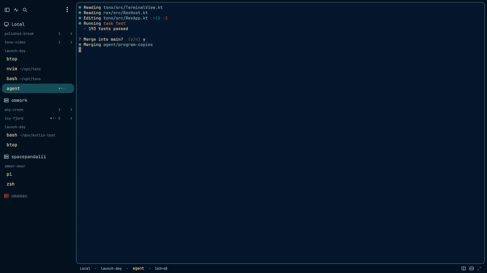
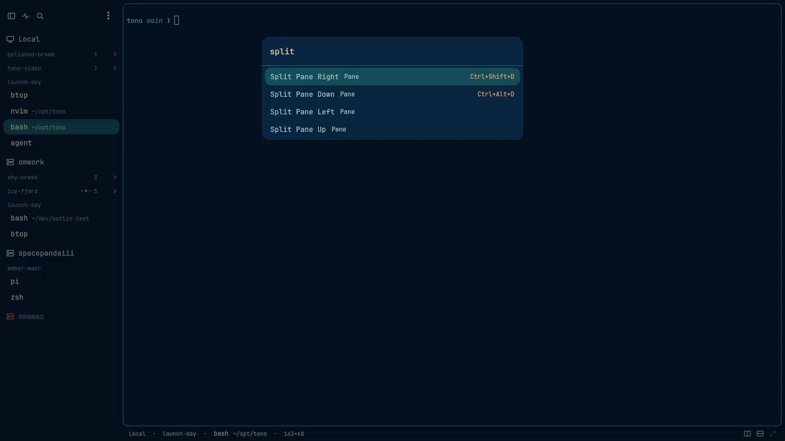

# Using Tono

When Tono starts, it connects to all your Rex servers at once and puts you back where you were on each one. It only
creates or closes things when you ask it to.

## Machines

Tono shows the local Rex server plus every host in that server's host list. This is the same list the `rex hosts`
command uses, so a host you add in Tono shows up in `rex hosts`, and a host you add with `rex hosts add` shows up in
Tono right away.

- To add a machine, use Add Host… in the palette, in the sidebar's menu, or at the end of the Switch Host list. It
  lists the Rex servers on your tailnet that you haven't added yet. You can pick one or type an address, and you can
  add a server even while it's down.
- To take a machine off the list, use Remove Host….
- An address is `https://host` for a server on the network, or `unix:///path` for a socket. A Rex server with
  built-in Tailscale is a device on your tailnet, so its `https://` address works from any machine on that tailnet.
- Tono also connects to any hosts listed in `~/.config/kotlin-test/workspace.json`. It only saves a host there when
  there's no local server to keep it.

If Tono can't reach a machine, the machine's icon turns red and nothing is listed under it. Tono retries every few
seconds until the machine answers. You can hover over the machine for a button that retries immediately, and the
debug log says why the connection failed.

A machine that goes to sleep or drops off the network never closes its connection. To catch that, Tono checks on
any server that has been silent for ten seconds, and marks it as down if it gets no answer within ten more. When
the machine comes back, Tono reconnects and reloads everything.

## The sidebar


The sidebar has three levels:

1. Machines come first. This machine is at the top, followed by the connected ones in name order and then the ones
   that are down. Each has a small icon: a screen for this computer and a rack unit for the others.
2. Sessions are listed under their machine, in small, dim text.
3. Tabs are listed under their session. A tab is what Rex calls a window. Tabs are what you're usually looking for,
   so they're the brightest items in the sidebar.

In the sidebar you can:

- Click a machine or a session to collapse it.
- Hover over a machine or a session to get a plus button. On a machine it creates a session, and on a session it
  creates a tab.
- Drag a tab to reorder it within its session, or drag a session by its name to reorder it among that machine's
  sessions. The server stores the new order, so every client sees it.
- Use the buttons at the top to hide the sidebar, show only the tabs with active programs, or open the palette.
  Hover over a button to see its name and shortcut. While the sidebar is hidden, a button to bring it back appears
  when you move the pointer to the top left corner of the window.

## Tabs

Tono names a tab after the program in the foreground of its focused pane and shows that program's directory next to
it, like `nvim ~/dev/rex`. The name updates as commands start and finish.

To name a tab yourself, double-click it or use Rename Tab… in the palette. Your name shows on every client and stays
until you clear it. If you save an empty name, the tab goes back to being named after its program.

A session always has at least one tab. When you close a session's last tab, the session closes too, as it does in
Rex's Mac app, and Tono switches to the session next to it.

## Activity and sounds



Three dots next to a tab show what its program reports it's doing:

- They ripple while the program is working.
- They hold steady in the accent color while it's waiting for you.
- They turn the error color after a failure.

A collapsed machine or session shows the dots for the tabs inside it. Programs report their state themselves, using
an escape sequence that Rex defines (OSC 7501).

Tono plays a sound when a program starts waiting for you, fails, or finishes in a tab you aren't looking at. It uses
your desktop's own sounds and plays them with `mpv`, the way Omarchy does. The tab you're looking at stays silent
while the window has focus. If several things happen at once you hear one sound, for the most urgent of them. You
can turn sounds off and on with Play Activity Sounds in the palette.

### Notifications

Tono also shows a desktop notification, which says what happened and where: `agent · Needs you` over the session
and machine. You get one when a program in a tab you aren't looking at starts waiting for you, fails, or finishes,
and when a program asks for one itself (OSC 9 or OSC 777). The tab you're looking at never notifies while the window
has focus.

- A tab's newest notification replaces its last one, so a busy tab leaves one notification and not a pile.
- Ones for a program that is waiting for you or has failed stay up until you dismiss them. The rest time out.
- Clicking a notification goes to its tab. Going to a tab any other way takes its notifications down.

On the desktop Tono shows them with `notify-send`, which comes with libnotify. In a browser the browser has to allow
them: the first time a tab has news, Tono shows a line at the bottom of the window with an Allow Notifications
button, and never asks before that.

Show System Notifications in the palette turns them all off and on, and Terminal Notifications does the same for the
ones programs ask for. Each kind also has a switch of its own in `~/.config/kotlin-test/workspace.json`, which Tono
reads when it starts:

```json
"notifications": {
    "system_notifications": true,
    "blocked": true,
    "error": true,
    "done": true,
    "program_messages": true
}
```

## The status line

The line at the bottom of the window shows where you are: the machine, the session, the tab and the terminal's size.
On its right are small buttons that split the pane right, split it down, and zoom it.

## Shortcuts and the command palette



Everything Tono can do is a command. Commands have the same names and shortcuts as in Rex's Mac app, with Ctrl in
place of Cmd, and with Shift added where Ctrl on its own already means something to the terminal.

| Keys | What it does |
| --- | --- |
| Ctrl+Shift+P | Command palette: every command, plus sessions, tabs and machines to go to |
| Ctrl+K | Change session, on any machine |
| Ctrl+Shift+H | Switch machine |
| Ctrl+1 … Ctrl+8, Ctrl+9 | Go to that tab; Ctrl+9 is the last tab |
| Ctrl+Tab / Ctrl+Shift+Tab, Ctrl+PageDown / PageUp | Next / previous tab |
| Ctrl+Shift+T / Ctrl+Shift+N, or Ctrl+Alt+T / Ctrl+Alt+N | New tab / new session |
| Ctrl+Shift+D / Ctrl+Alt+D | Split the pane right / down |
| Ctrl+Alt+arrows | Focus the pane in that direction |
| Alt+] / Alt+[ | Focus the next / previous pane |
| Ctrl+Shift+Enter | Zoom the pane, or restore the layout |
| Ctrl+Shift+W / Ctrl+Alt+W | Close the pane / the tab, after asking |
| Ctrl+Shift+C / Ctrl+Shift+V | Copy the selected text / paste |
| Ctrl+Shift+A | Select everything in the terminal, including its history |
| Ctrl+click | Open the link under the pointer |
| Shift+PageUp / Shift+PageDown | Scroll through history |
| Ctrl+= / Ctrl+- / Ctrl+0 | Larger / smaller / default text |
| Ctrl+Shift+/ | Show or hide the sidebar |
| Ctrl+Shift+. | Show only the tabs whose programs are active, or every tab again |
| Ctrl+` | Show or hide the debug log |

Tabs are numbered as one list, in sidebar order, across every session and machine. Ctrl plus a number goes to that
tab whichever session it's in, and next and previous tab continue from one session into the next. Hold Ctrl to see
each tab's number. Tabs inside a collapsed session or machine aren't numbered, so collapsing what you aren't using
brings the other tabs within reach of a number.

A key that's bound to a command doesn't reach the terminal, and every other key does. The bindings aren't built
into the app. Tono tells your home server which commands it has and what their default keys are, and the server
replies with the final bindings after applying your Rex configuration. That's why a key you bind in Rex's
`init.lua` works in Tono the same way it does in the Mac app.

The debug log (Ctrl+`) is a panel at the bottom of the window that shows what Tono is doing: its connections, the
events servers send, the requests that change something, and the commands it runs. It never records what you type.

## Selecting and copying

Drag across a terminal to select text. Double-click selects a word and triple-click a line, and dragging after
either carries on a word or a line at a time. Dragging past the top or bottom of the terminal scrolls it. Ctrl+Shift+C
copies what's selected, and Ctrl+Shift+A selects everything, including the history.

A program that uses the mouse itself, such as Neovim, htop or tmux, gets your clicks and drags. Hold Shift while
you drag to select there anyway.

The selection stays on its text. When more output arrives the highlight moves up with the lines it's on, and you
can still copy them after they've scrolled out of view. Clicking, or typing into the terminal, clears it. So does
a program that clears the screen.

## Opening links

Hold Ctrl and click a link to open it. An address written out in the output is a link, including one too long for
its row that the terminal wrapped onto the next. So is text that a program made a link, as `ls --hyperlink`, `gh`
and many others do.

While Ctrl is held, the link under the pointer is underlined, and after a moment its address is shown beside it.
For a link a program made, that's the address the program gave, which is where the click goes, whatever the
text says.

Only `http`, `https`, `ftp` and `mailto` links are opened. Anything else is not a link to Tono, and in particular
not `file:` addresses: what a terminal shows may come from another machine, and shouldn't be able to open a file
on yours. The desktop app hands the address to `xdg-open`, which opens your default browser or mail program. In
a browser, the link opens in a new tab.

Ctrl+click on a link works over a program that uses the mouse too, and the program isn't told of that click.
Anywhere else, Ctrl+click is an ordinary click.

## Sharing a terminal with other clients

A terminal takes its size from one client at a time, and that should be the client someone is actually using. Tono
claims the terminals on screen while its window has focus, and also when you type, click or move the pointer in
one. If another client takes a terminal back, Tono leaves it alone until you use it again, so two clients don't
keep resizing the same terminal. When Tono doesn't have focus, it draws each terminal at the size its owner set.

Each client chooses which tab it shows. Two clients on the same session share its terminals, so each sees what the
other types. Switching tabs in Rex's Mac app doesn't switch tabs in Tono, though, and switching in Tono doesn't
affect the Mac app.

## What's missing

- SSH hosts aren't supported.
- Floating panes aren't drawn as windows.
- Animated images show only their first frame.
- The keymap doesn't support key sequences or modes.
- Keys are named for a US layout. On other layouts some shortcuts may be read as the wrong key, though what you
  type is still correct.

The rest of what's planned is in [the backlog](../agent-workspace/backlog/readme.md).
