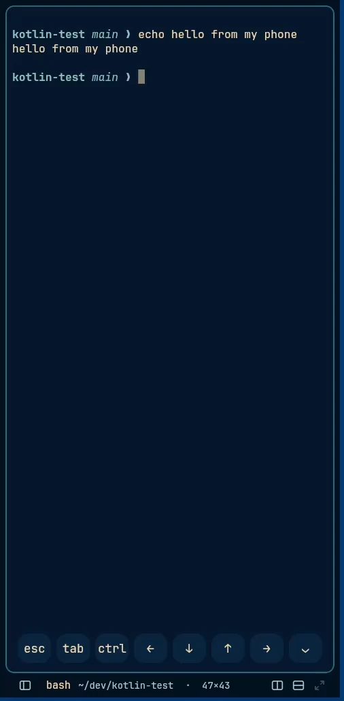

# Tono in a browser


`task web` serves Tono as a web page at http://127.0.0.1:8080. It's the same code as the desktop app, so the
sidebar, terminals, palette, dialogs and shortcuts all work the same way. A web page isn't allowed to do everything
a desktop app can, so a small server handles those parts for it.

```sh
task web           # serve it, to this machine only
task web:tailnet   # beside it: let your other devices in, over your tailnet
```

## Who can reach it

By default, only this machine can.

`task web:tailnet` makes it available on your tailnet at `https://<this machine>.<your tailnet>.ts.net/` by running
`tailscale serve`. Tailscale only accepts connections from your tailnet, and it passes them to the server on this
machine's local address. Nothing is exposed to the internet.

A tailnet can have other people on it, so the server also checks who is asking. Like a Rex server, it only lets in
the Tailscale user who owns this machine. For each request it asks Tailscale whose device it came from, and it
answers 403 to devices that belong to someone else and to tagged machines that have no owner. Set
`TONO_ALLOW_IDENTIFIED=1` if you want to let in everyone Tailscale can identify.

Anyone who can open the page can use your terminals as you, so be careful who that is.

Two other things to know:

- Rex servers see every browser as this machine, because this machine is what connects to them. To help you tell a
  phone from a laptop in a server's client list (`rex client ls`), the page reports the name of the device it's
  open on and identifies itself as a `web` client.
- Like every Rex client, a page only takes over a terminal's size while you're using it. A page whose window
  doesn't have keyboard focus leaves sizes alone, and closing a page hands the size back.

## The keyboard

Browsers act on any key a page doesn't handle, and most keys a terminal uses also mean something to a browser. Tono
handles them all itself: it doesn't leave the browser any key combined with Ctrl or Alt, or any function key. That
means Ctrl+P goes to the shell and Ctrl+Shift+P opens the palette, and neither opens the print dialog. Copy and
paste in text fields, reloading and the developer tools still work.

A few keys never reach a page in a normal browser tab: Ctrl with T, N, W or Tab, and the Shift versions of those.
There are three ways around that:

- Go full screen with F11 or Toggle Full Screen in the palette. In Chromium browsers the page then gets every key.
  Escape goes to the terminal, and holding Escape leaves full screen.
- Install the page as an app, using the install button in the address bar. It gets its own window, which also
  receives every key.
- Stay in a normal tab and use the alternatives. New Tab is also on Ctrl+Alt+T and New Session on Ctrl+Alt+N, and
  going to a tab by number works as usual. Ctrl+W still closes the browser tab. Because that key deletes a word in
  a shell, the page asks before it closes.

## On a phone



When the window is too narrow to show the sidebar and a terminal side by side, Tono shows one at a time. You pick a
tab in the sidebar, the tab opens, and a button in the status line takes you back. Touching a terminal brings up
the on-screen keyboard, with an extra row above it for keys a phone keyboard doesn't have: Escape, Tab, Ctrl and
the arrows. Ctrl applies to the next key you type.

The image above was taken in a desktop browser's phone mode. Tono hasn't been run on a real phone yet.

## What's been tested

| Browser | What's been tested |
|---|---|
| Chromium | Terminals, images, the palette, tooltips, paste, a program copying to the clipboard, sounds, renaming and dragging tabs, the mouse, reconnecting, and the keys described above in a real window (a tab, an app window and full screen). The phone layout and typing on it were tested in Chromium's phone emulation. |
| Firefox | Loading, typing, the palette and images. |
| Safari, and any real phone or tablet | Not tested. The keyboard is the most likely thing to go wrong first. The sounds are Ogg files, which older versions of Safari don't play. |

## What the server does for the page

- Ghostty's terminal core runs in the page as a WebAssembly module, built from the same pinned source as the
  desktop library (`task native:wasm` builds it in about half a minute). Calling it one function at a time from
  Kotlin is slow in a browser, so [ghostty-glue.js](../webApp/resources/ghostty-glue.js) does the cell-by-cell work
  next to the library and returns a whole frame at once. Upstream Ghostty leaves images out of its WebAssembly
  build, and [a small patch](../native/ghostty-vt-wasm.patch) adds them back.
- A page can't open the local Rex server's socket, and a Rex server refuses WebSockets that come from another
  site's page. So the page connects to [a relay](../server/src/TonoRelay.kt) on its own server, which opens the
  real connection and passes messages in both directions without reading them. The relay only serves its own page,
  so other sites open in your browser can't use it, and it only connects to this machine's Rex server and to Rex
  servers on your tailnet.
- The theme follows the desktop live, as it does in the desktop app. The server also sends the desktop's monospace
  font, so terminals use the same glyphs, and the desktop's sounds. When a character isn't in that font (a Chinese
  character or an emoji, for example), the page fetches a Noto font from Google's font service the first time it
  needs one. Compose does this in every web app, and it's the only request the page makes to the internet.
- Your settings, such as which machines are collapsed and which tab you were on, are stored in the browser, so each
  browser has its own.
- The page is sent compressed, and the server tells a browser when it already has a file instead of sending it
  again. A first visit downloads about 12 MB before anything appears, 10 MB of which is the app (8 MB with
  `task web:release`). Later visits download almost nothing.

The access check is in [TailnetOnly.kt](../server/src/TailnetOnly.kt), and the keyboard handling is in
[page-keys.js](../webApp/resources/page-keys.js).

## Running a release build

`task web:release` builds the optimized web app and a self-contained server jar, then runs them without any build
tool involved. The server reads `WEB_DIR`, `HOST` (default `127.0.0.1`) and `PORT` (default `8080`) from the
environment.
