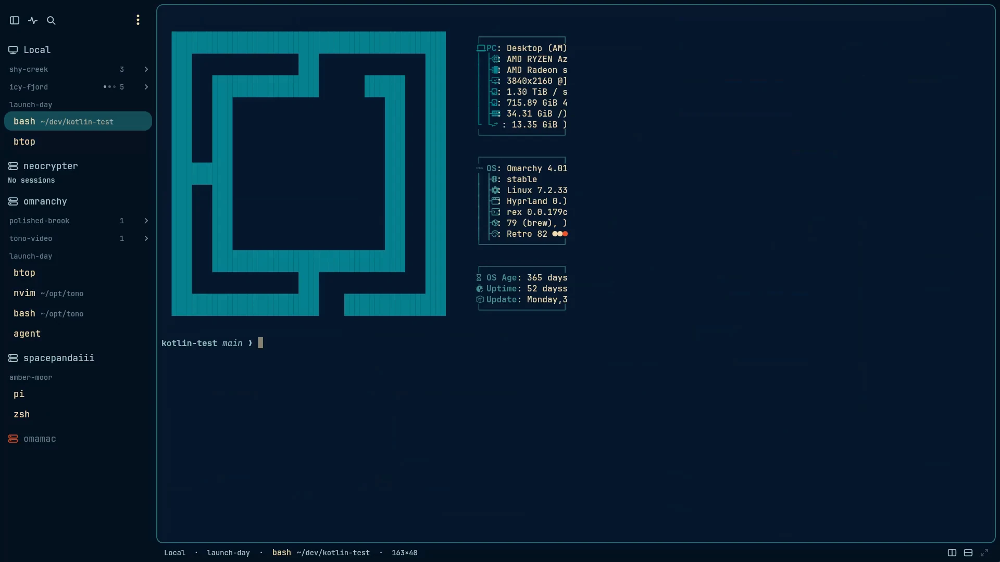

# Tono in a browser



`task web` serves Tono as a web page at http://127.0.0.1:8080. It is the desktop app's own code: the sidebar,
terminals, palette, dialogs and shortcuts are the same. What differs is what a page isn't allowed to do, which a
small server does for it.

```sh
task web           # serve it, to this machine only
task web:tailnet   # beside it: let your other devices in, over your tailnet
```

## Who can reach it

**By default, only this machine.**

`task web:tailnet` puts it on your tailnet at `https://<this machine>.<your tailnet>.ts.net/`, using
`tailscale serve`. Tailscale accepts connections from your tailnet alone and passes them to the server on this
machine's own address. Nothing is opened to the internet.

**Being on the tailnet is not enough**, since a tailnet can have other people on it. Like a Rex server, this one lets
in only the Tailscale user who owns this machine. It asks Tailscale whose device each request came from, and a
device that is someone else's, or a tagged machine with no owner, gets a 403. Setting `TONO_ALLOW_IDENTIFIED=1` lets
in everyone Tailscale can put a name to.

Keep in mind what the page is: whoever can open it is at your terminals, as you.

Two more things worth knowing:

- **Rex servers see every browser as this machine**, because it is this machine that connects. So that a server's
  list of clients can tell a phone from a laptop, the page gives the name of the device it is open on
  (`rex client ls`), and says it is a `web` client.
- **A page takes a terminal's size only while it is being used**, like every Rex client. A page whose window
  doesn't have the keyboard leaves sizes alone, and closing a page gives the size back.

## The keyboard

A browser acts on any key a page lets through, and most of a terminal's keys mean something to a browser. Tono
keeps them: nothing with Control or Alt, and no function key, is left for the browser. So Control+P is the shell's,
and Control+Shift+P is the palette, never the print dialog. Copy and paste in a text field, reloading, and the
developer tools still work.

Some keys a browser never shows a page in a tab at all: Control with T, N, W or Tab, and their Shift forms. For
those you have three ways:

- **Full screen** (F11, or Toggle Full Screen in the palette) gives the page every key, in Chromium browsers.
  Escape goes to the terminal; hold it to leave.
- **Install the page as an app** (the install button in the address bar). It gets a window of its own, and every
  key too.
- **In a plain tab**, New Tab and New Session have a second key, Control+Alt+T and Control+Alt+N, and going to a
  tab by number works as it is. Control+W still closes the browser's tab, and in a shell that key deletes a word,
  so the page asks before it goes.

## On a phone


A window too narrow for the sidebar and a terminal side by side shows one at a time: the sidebar to choose a tab,
then the tab, with a button in the bottom line to go back. Touching a terminal brings up the keyboard, and a row of
the keys a phone's keyboard lacks appears over it: Escape, Tab, Control (which goes with the next key you type) and
the arrows.

The picture is a desktop browser's phone mode. No real phone has run it yet.

## What has been tried, and what hasn't

| | |
|---|---|
| **Chromium** | Terminals, pictures, the palette, tooltips, paste, a program copying to the clipboard, sounds, renaming and dragging tabs, the mouse, reconnecting, and the keys above in a real window (a tab, an app window and full screen). The phone layout and its typing, in Chromium's emulation of a phone. |
| **Firefox** | Loading, typing, the palette and pictures. |
| **Not tried** | Safari, and any real phone or tablet. Expect the keyboard to be where it goes wrong first. The sounds are Ogg files, which older Safari versions don't play. |

## What the server does for the page

- **Terminals.** Ghostty's terminal core runs in the page as a WebAssembly module, built from the same pinned
  source as the desktop's library (`task native:wasm`, half a minute). Calling it one function at a time from
  Kotlin is slow in a browser, so [ghostty-glue.js](../webApp/resources/ghostty-glue.js) does the cell-by-cell work
  beside the library and hands over a whole frame at once. Upstream leaves pictures out of the WebAssembly build;
  [a small patch](../native/ghostty-vt-wasm.patch) puts them back.
- **Connections.** A page can't open the local server's socket, and a Rex server refuses a WebSocket that says it
  comes from another site's page. So the page connects to [a relay](../server/src/TonoRelay.kt) on its own server,
  which makes the real connection and passes messages both ways, unread. The relay serves only its own page, so
  another site open in your browser can't use it, and it connects only to this machine's Rex server and to Rex
  servers on your tailnet.
- **The desktop's look.** The theme follows the desktop live. The server also hands over the desktop's monospace
  font, so terminals have the same glyphs as on the desktop, and its sounds. A character that font doesn't have
  (Chinese, say, or an emoji) is drawn in a Noto font that the page fetches from Google's font service the first
  time one appears. Compose does this for every web app, and it is the one thing the page asks of the internet.
- **Your settings** (machines folded, the tab you were on) are kept in the browser, so each browser has its own.
- **Size.** The page is sent compressed, and a browser that already has a file is told so instead of being sent it
  again. A first visit downloads about 12 MB before anything shows, 10 MB of it the app (8 MB with
  `task web:release`); later visits, next to nothing.

The access rule is in [TailnetOnly.kt](../server/src/TailnetOnly.kt), and the keyboard handling in
[page-keys.js](../webApp/resources/page-keys.js).

## Running it for real

`task web:release` builds the optimized web app and a self-contained server jar and runs them, with no build tool
involved at runtime. The server reads `WEB_DIR`, `HOST` (default `127.0.0.1`) and `PORT` (default `8080`) from the
environment.
